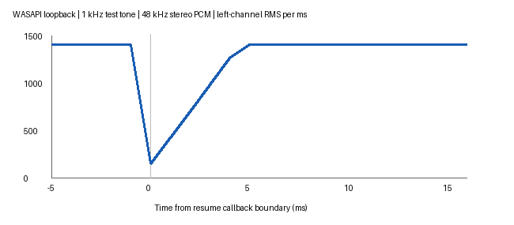

# Windows recording acceptance, 2026-11-28

Local verification for [issue #385](https://github.com/victorfu/snap-tray/issues/385) at commit `1be013bac739de1a610c54b6cf0b89897fb81e33`. Windows 10 Pro 22H2 build 19045.7846, GeForce GTX 1650 driver 32.0.15.9649, Qt 6.12.0, MSVC Debug. The desktop was extended across a 2560×1440 ROG PG279Q at 150% and a 3840×2160 UHD HDR display at 250%.

## Recorded duration and display dimensions

A local driver linked to the current build called the production RecordingManager with isolated settings. A full-screen window displayed a changing timestamp for 30 seconds, then held a still picture. The driver paused recording for two seconds, resumed, held for approximately six seconds, then stopped. Each run included a three-second countdown. Audio was off. The saved MP4 or edit-mode intermediate was opened with a Media Foundation source reader. At 30 fps the allowed difference from the final session recordedMs is 33.33 ms.

| Backend and mode | recordedMs | MP4 duration (ms) | Absolute difference (ms) | Offered / encoded |
| --- | ---: | ---: | ---: | ---: |
| WGC quick | 35,993 | 35,992.600 | 0.400 | 960 / 960 |
| WGC edit | 36,024 | 36,024.667 | 0.667 | 960 / 960 |
| DXGI quick | 35,989 | 35,990.633 | 1.633 | 778 / 778 |
| DXGI edit | 36,003 | 36,003.100 | 0.100 | 774 / 774 |

All four files were 2560×1440. All four paths used native frames and reported zero queue drops and encoder rejections. On the 250% display, a separate WGC quick run with a continuously changing counter for a requested 30 seconds produced a 3840×2160 MP4 lasting 30,018.433 ms. The absolute differences were 18.433 ms from the requested interval and 0.433 ms from recordedMs. Click hotspots were outside this measurement. [Container dimensions and sample counts](media.json)

## Sparse playback and editing

The source for these checks was the WGC quick recording above. The source and re-exports are retained on the test machine in `build/qa385/`. [Sample SHA-256 hashes](playback-samples.json) · [VLC sparse-tail timing](Recording_20261128_192611-tail.json) · [VLC control timing](cropped-tail.json)

| Path | Observation |
| --- | --- |
| Windows Media Player (legacy COM player) | Playing state and advancing position after seeks to 34.993 s, 1 s, and 17 s. Reported duration 35.9926 s. [Player readings](wmp-pump.txt) |
| Chrome (installed browser, headless HTML video) | Playback advanced and pixel reads succeeded after seeking near the end, back to 1 s and to the midpoint. HTML video reported 35.890733 s, about 102 ms shorter than Media Foundation. [Browser readings](chrome.json) |
| VLC 3.0.24, Direct3D11 output and software decoding | Playback advanced after seeks to 1 s, 17.996 s and 30.993 s. From five seconds before the declared end it reached Ended in 4.094 s. The same check took 5.109 s on the cropped control. The sparse tail fell short in this playback path. A separate headless dummy-output probe crashed on the source, while the control played. [Player state trace](vlc-d3d-playback.json) |
| SnapTray Media Foundation transcoder | Reopened the sparse MP4, selected 29–35 s across the transition to the final hold, cropped the central 1280×720 rectangle and re-encoded H.264. Probing the output returned 1280×720, 6013 ms, within one 30 fps frame of the six-second selection. |

## 1080p GIF

A 1920×1080 crop from the first ten seconds of the real recording supplied both preview-backend GIF exports. The MP4 source probed at 10,009 ms. Decoding every GIF frame gave the following results. [Decoded GIF measurements](media.json)

| Preview export | Bytes | Frames | Duration |
| --- | ---: | ---: | ---: |
| Default, 1920×1080 | 2,248,877 | 261 | 10,010 ms |
| 640×360, 15 fps, Medium | 305,412 | 151 | 10,010 ms |

The compact export reduced file size by 86.42%, above the 70% target for this sample. Its duration differed from the source by 1 ms. The scene contained no click effects.

## WASAPI resume

A 1 kHz test tone played through the default console render endpoint, ROG PG279Q (NVIDIA High Definition Audio). SnapTray's WASAPI system-audio engine captured real loopback PCM at 48 kHz, stereo, signed 16-bit. The probe paused for 2011 ms before resuming. On the left channel the first five 1 ms RMS readings after resume were 150, 418, 698, 979 and 1260. The sixth reached the pre-pause level of 1405. This meets the five-millisecond waveform check. Headphone listening remains open. [Per-millisecond measurements](loopback.csv)

## Shape position in three exports

On the real screen recordings, the preview backend placed a cyan content-space rectangle and a magenta screen-space rectangle. The view was twice the output dimensions. Each format exported the first second. At 400 ms the reference used the preview content painter and screen overlay item, then downscaled to video pixels. Each comparison thresholded the two colors and measured all four bounding-box edges. [Per-format bounds](shapes.json)

| Scene | MP4 maximum edge error | GIF maximum edge error | WebP maximum edge error |
| --- | ---: | ---: | ---: |
| 1920×1080 cropped to 1280×720 | 1 px | 0 px | 1 px |
| 3840×2160 uncropped | 0 px | 0 px | 0 px |

These are shared-time measurements at a single playhead position. Animated zoom, pan, project reopening and frame-by-frame alignment remain open.

## Build and regression coverage

The canonical Windows Debug build succeeded. The 71 selected RecordingManager, Encoding, Video, recording QML and window-capture-affinity CTest targets completed in 762.43 seconds with zero failed targets. Qt Test reported 30 skipped cases across those targets, including the Windows-unavailable FFmpeg decoded-media sync matrix. The Windows GPU capture suite ran the hardware and WARP frame comparers, checked small-picture changes after a still span, and reported 670 accepted timestamps, zero duplicate timestamps and zero backwards timestamps in its ten-second changing/static test.

## Countdown, first change and sparse capture

At a requested 60 fps the timestamp pattern changed every 16 ms for ten seconds, stayed still for twenty seconds, then changed once. A callback counted CPU images and summed the desktop-copy flags delivered by the actual capture engine. A 5 ms GUI timer measured event-loop responsiveness. The CPU column is process CPU time per wall second, including the pattern generator. GPU is the sum of Windows GPU Engine utilization counters matching the process ID, sampled about every 850 ms. These compare two phases of the same build. A pre-optimization revision was outside this run.

| Measurement | WGC | DXGI |
| --- | ---: | ---: |
| Frames admitted before recording | 0 | 0 |
| CPU images / desktop copies during countdown | 0 / 139 | 0 / 143 |
| First backend delivery after entering Recording | 12.0 ms | 8.2 ms |
| Backend deliveries during twenty seconds still (1200 at fixed 60 fps) | 13 | 12 |
| Desktop copies during the still phase | 2 | 2 |
| First new picture after requesting the final change | 14.9 ms | 43.3 ms |
| Process CPU, dynamic → still (ms/s) | 445 → 73 | 377 → 9 |
| GPU engine utilization sum, dynamic → still | 30.13% → 3.83% | 27.29% → 0.22% |
| Longest observed GUI heartbeat interval | 930 ms | 723 ms |

The per-phase counters and recording diagnostics are preserved in the [capture measurements](capture-measurements.txt). The countdown therefore did GPU copy work on both paths. Both reduced still deliveries by at least 98.9%. The DXGI change arrived more than two 60 fps intervals after the UI requested the repaint. This includes Qt painting and desktop composition. Per-frame visual IDs and the capture timestamp of the first painted change would be needed to attribute that delay.

## Color bars

The full-screen WGC test displayed white, yellow, cyan, green, magenta, red, blue and black. The two decoded MP4 frames showed the eight bands in order with distinct black and white endpoints. Maximum absolute RGB-channel error at the bar centers was 2 levels with CPU image input and 1 level with native GPU input. In both H.264 sequence parameter sets, primaries, transfer and matrix were 1 (BT.709), and full-range was 0 (limited). The native Media Foundation media type did not expose these attributes; the values came from parsing the actual bitstreams. [Color measurements](color.json) · [Decoded CPU frame](bars-cpu.png) · [Decoded GPU frame](bars-gpu.png)

## Teleprompter lifecycle

On the extended desktop, quick and edit sessions each rejected same-display setup and left zero reader windows. With the secondary display selected for the reader, each mode showed one enabled reader during recording, disabled it on pause and enabled it on resume. Cancel removed the reader. Restarting in the same process recreated exactly one reader, and stopping removed it before quick-save or preview. Monitor unplugging was outside this test.

The opt-in captured-pixel test passed on DXGI with either physical display as the source and on the Qt fallback. The WGC secondary-display row stopped making progress after the engine reported starting. The combined run exceeded the repository timeout, and both standalone retries reached the 60-second limit at the same log entry. WGC prompter exclusion remains unverified on this build. The logs do not distinguish a test-harness hang from a capture-engine hang. [Combined run](prompter-display.txt) · [First standalone retry](prompter-wgc-1.txt) · [Second standalone retry](prompter-wgc-2.txt)

## Ten-second CPU saturation

Two separate WGC quick recordings played the test tone with microphone and system audio enabled. Twenty-four workers loaded the machine for ten seconds. System busy time was calculated from GetSystemTimes. A precise 5 ms timer ran on the GUI thread.

- **Stress from startup.** Measured CPU busy time was 99.83%. The longest GUI dispatch interval was 6973 ms in Preparing, exceeding the 50 ms limit. The recording entered Recording after the load ended. This measures the scheduling delay seen by the user, including competition from the load workers.
- **Stress starting at recordingStarted.** CPU busy time reached 100%. All 285 offered video frames encoded, with zero reported video stalls. Audio queued 1330 packets and dropped 49 packets (80,644 bytes accounted for as silence). System audio reported 47 gaps (34,064 frames) and 58 trimmed frames. The microphone reported 178 gaps (32,865 frames) and 177 trimmed frames. Both had zero timestamp errors and zero realignments. This run did not reproduce the zero audio packet loss seen in an earlier acceptance run.

## Open Windows coverage

The Intel UHD 620 machine specified in #422 is still required for its driver-reset, small-change and tail-duration recheck. This machine supplied 150% and 250% displays. Physical button mapping, real click and drag sidecars, UI-click filtering, Release hook timing, 100%/200% click geometry and enlarged/inverted/custom cursors remain open. Other outstanding checks include UAC and lock recovery, exclusive fullscreen and device reset, physical display and audio-device changes, subjective headphone listening, QuickTime playback, and the remaining editor, recovery and animation workflows listed in the issue. Hardware-independent regression results are recorded separately above.
